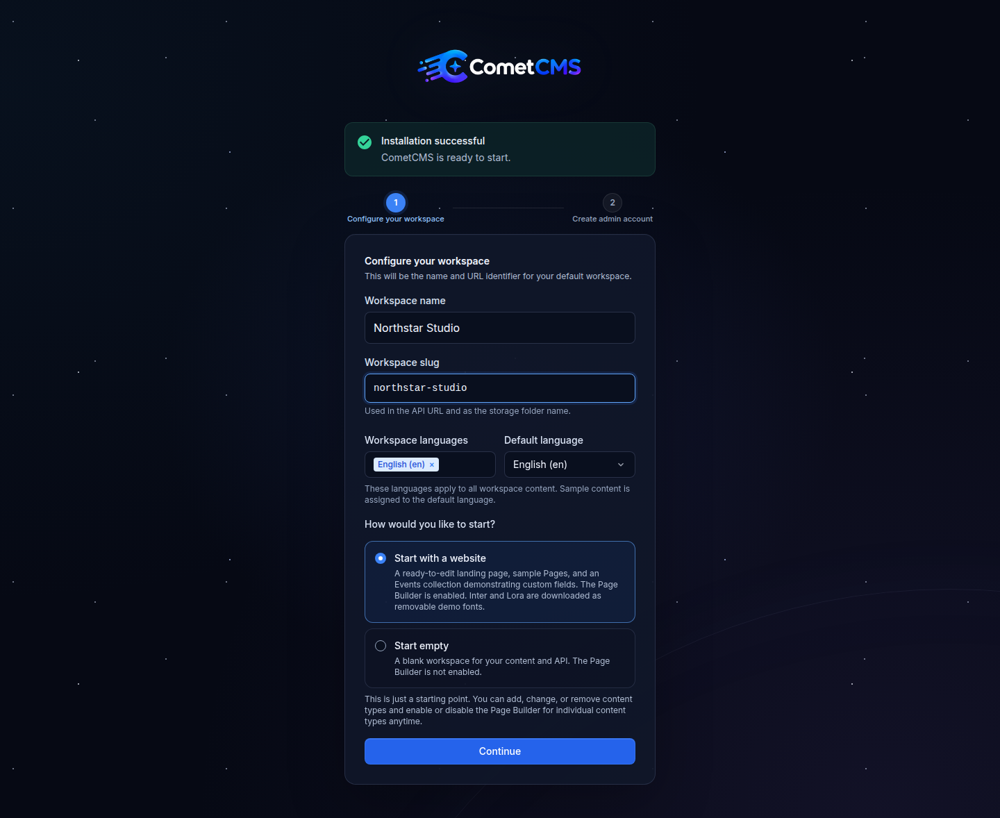

# Contributing to CometCMS

## Local Development

PHP 8.2+ and Node 24 LTS must be installed locally. No Composer or database needed.
The Node version is pinned in `.nvmrc`, which is also used by the CI, release, and documentation workflows. If you use a Node version manager, select that version before installing dependencies.
I'm primarily a JavaScript developer so the setup is done with npm scripts and Makefile commands, but the PHP code is vanilla and does not require a local server to run tests or build.

```bash
npm install   # install workspace dependencies
make dev      # start PHP + Vite together
```

Open `http://localhost:8000/admin`. The first visit shows the setup screen.

<p align="center">
  
</p>

## Build for production

```bash
make build
```

This assembles a deployment-ready `dist/` folder containing the PHP CMS, compiled admin UI in `dist/admin/`, config, rewrite files, and clean storage placeholders. Upload the contents of `dist/` to your server; production does not need Node.

## Website fonts

Website font files are not shipped in the CMS. The admin's website starter downloads Inter and Lora through the normal catalogue installer and stores them inside the new workspace as removable installed fonts. Empty workspaces use system fonts only. A download failure leaves the website working with system fonts; users can install families later in Manage fonts.

After a production build, `node tests/browser/typography.mjs` checks the font manager, uploads, live previews and a real catalogue installation using PHP and Chrome. It uses an isolated temporary installation. Add `--offline` to skip online catalogue access. The browser test needs Node 22+ and Chrome/Chromium (`CHROME_BIN` may override the executable).

The small font fixtures and their licences under `tests/fixtures/fonts/` are used only by tests and are excluded from production builds. They cover variable weights and static italics without requiring a network connection.

## Testing

The builder guide includes four short recordings of the real editor. To regenerate
the MP4 videos and WebP posters in `web/src/assets/builder-guide/`, install PHP,
FFmpeg and the Playwright browser dependencies, then run:

```bash
npx playwright install chromium ffmpeg
npm run record:builder-guide
```

Set `CHROME_BIN=/path/to/chrome` to use an existing Chrome installation. The
recorder builds and sets up a temporary CMS, demonstrates adding elements,
inline editing, device previews, and saving with history, then removes the
temporary installation. The videos are silent and use the English interface;
the guide provides translated descriptions and playback controls.

Run the full local test suite before shipping:

```bash
make test
```

That command lints PHP and Vue files, runs the Composer-free backend tests in `tests/php`, and runs the Vue/Vite unit tests with Vitest. For the same verification CI performs before a release build, run:

```bash
make ci
```

You can also run the layers independently:

```bash
make test-backend
make test-frontend
npm --workspace web run test:watch
```

Run `node tests/browser/link-modal.mjs` with PHP and Chrome/Chromium installed to check internal link modals, embedded pages and their height, browser history, links inside the modal, external links, keyboard and focus behavior, small screens, a custom drawer template, previews and root/subdirectory installs under the real content security policy. Set `CHROME_BIN` to override the browser executable. The test uses an isolated temporary installation.

After `npm run build`, add `--builder` to also check the **Modal** template in the builder's header dropdown, selecting its panel, its content placeholder, saving a panel option, reloading, full-page previews and the resulting live modal.

## Documentation and screenshots

The documentation lives in `docs/` and uses VitePress. Build it separately from the CMS:

```bash
npm --prefix docs ci
npm --prefix docs run build
```

Check UI labels and navigation against `web/src`, API routes against `cms/index.php`, and request/response behavior against the controllers and `docs/public/api/openapi.yaml` when updating the guides.

Refresh the browser screenshots with fictional data:

```bash
npx playwright install chromium
npm run docs:screenshots
```

The capture needs PHP with `zip` and GD, Node 24, Playwright Chromium, and outbound HTTPS to Iconify for the admin icons. Set `CHROME_BIN=/path/to/chrome` to use an existing browser. It builds a temporary installation, seeds fictional studio pages, translations, users, tokens, media, workspaces and a backup, and captures the actual admin UI. It never uses the local `cms/storage/` data. Demo webhooks are disabled. Temporary data is removed after success or failure, and browser errors or failed admin requests fail the capture.

Images are saved in `docs/screenshots/` and used by the guides, README and documentation homepage gallery. Review their framing and text after changing the UI, then rebuild the docs to check image references.

## Local reset

To wipe all data and return to the setup screen, just delete the storage folder. To remove accounts, roles, tokens, workspace data, sessions, logs, backups, updates, and runtime settings while keeping the directory protection files, run:

```bash
rm -f cms/storage/users/*.json
rm -f cms/storage/roles/*.json
rm -f cms/storage/api-tokens/*.json
rm -rf cms/storage/workspaces/*
rm -f cms/storage/sessions/*
rm -f cms/storage/logs/*.log
rm -f cms/storage/backups/*.zip
rm -rf cms/storage/updates/*
rm -f cms/storage/settings.json
```

## Pull Requests

1. Ensure your fork is up to date with the `main` branch.
2. Run `make ci` to verify everything passes before opening a PR.
3. Write a clear PR description explaining what your changes do and why.
4. Keep changes focused — one feature or fix per pull request.

## Reporting Issues

Found a bug or have a feature request? Open an issue on the [GitHub repository](https://github.com/GetCometCMS/CometCMS/issues). Please include:

- A clear, descriptive title.
- Steps to reproduce the issue (if applicable).
- Expected vs. actual behavior.
- Screenshots or error logs where helpful.

## Code Style

- **PHP:** PSR-12 inspired. The test suite includes a lint step that validates basic formatting.
- **Vue / JavaScript:** ESLint via the `web` workspace. Run `npm --workspace web run lint` before committing.
- Keep it simple. CometCMS intentionally avoids frameworks, compilers, and complex abstractions on the PHP side.
