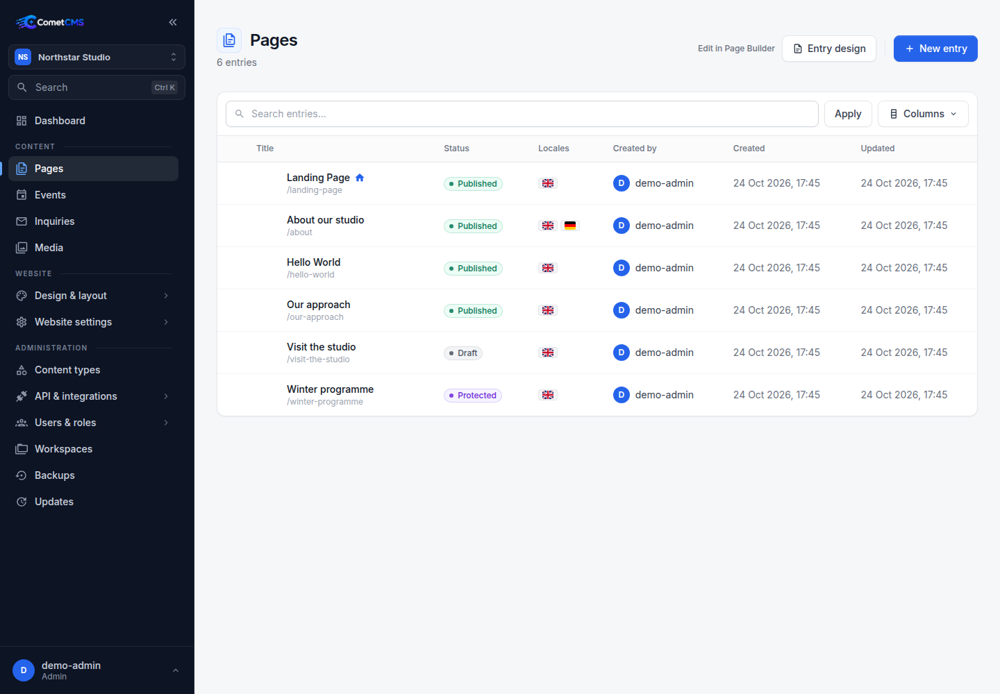
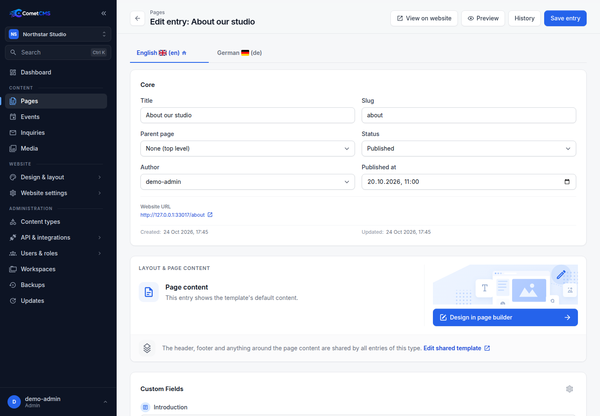

# Content Entries

## Browsing entries

Select a collection from the **sidebar** to see a list of all entries in that collection. The list shows entry titles, publication status, and other columns selected for the collection. Hierarchical collections such as Pages can display entries as a tree.

## Creating an entry

1. Open a collection from the sidebar.
2. Click **New entry**.
3. Fill in the fields.
4. Click **Save entry**.

Entries start as **Draft**. Choose **Published** in the **Status** dropdown to publish, then save. Set a future **Published at** date to schedule publication. **Protected** entries require authorized access; **Archived** entries stay out of public reads. Custom boolean and datetime fields do not control publication.

New entries start in the workspace default language unless you choose another enabled language. Each language has its own slug, publication status, and publication date; authors and stable IDs are shared.

## Editing an entry

Click any row in the list to open the entry editor. Changes are saved when you click **Save entry**.

Language tabs above the form let you switch between translations. Missing translations show a plus icon; select one to start a new locale variant. The language selector identifies the default locale. Deleting a locale variant only removes that translation; the entry and other locales remain. Source text and inherited-value indicators appear beside translated fields. **Reset to default language** removes an override. A source change marks saved translations for review without changing their text. Saving preserves drafts prepared in other language tabs. A stale save reports a conflict and keeps the draft.

## Entry history

Every time you save an entry, a revision snapshot is stored. CometCMS keeps up to `content.max_revisions` snapshots per entry, which defaults to `55` in `config/config.php`. Set it to `0` to disable revision history, or a negative value to keep revisions indefinitely.

Open the **Entry history** side panel to:

- Browse all previous versions, including which user saved each one.
- See a **diff** of what changed between each revision.
- **Restore** any revision by clicking the restore icon — this loads the old values into the editor without saving. Review the changes and click **Save entry** to apply.

The top of the history list always shows the **current** state with a blue _(Current)_ badge.

## Deleting an entry

Click **Delete** on an entry to move it to the **Trash**. Trashed entries can be restored or permanently deleted from the Trash section.

## Entry metadata

Every entry includes these system fields. IDs and timestamps are managed automatically; users with edit access can select the author in the entry editor:

| Field        | Description                                          |
| ------------ | ---------------------------------------------------- |
| `id`         | Unique identifier (auto-generated).                  |
| `collection` | The collection this entry belongs to.                |
| `created_at` | ISO 8601 timestamp when the entry was first created. |
| `updated_at` | ISO 8601 timestamp of the last save.                 |
| `author_id`  | Assigned author (initially the entry creator).                |
| `updated_by` | ID of the user who last updated the entry.           |
