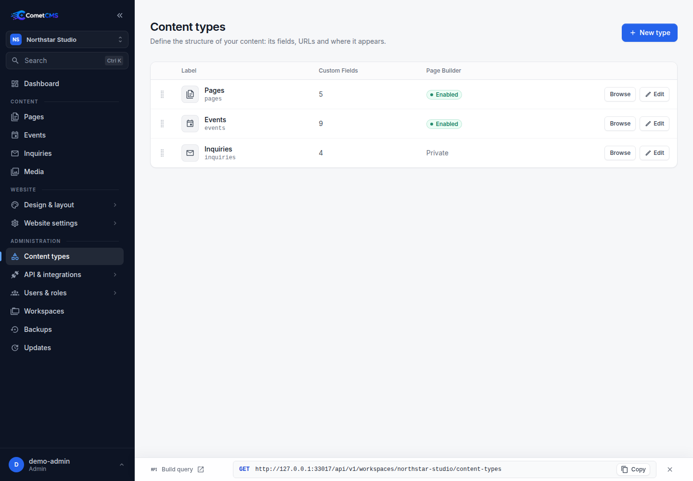
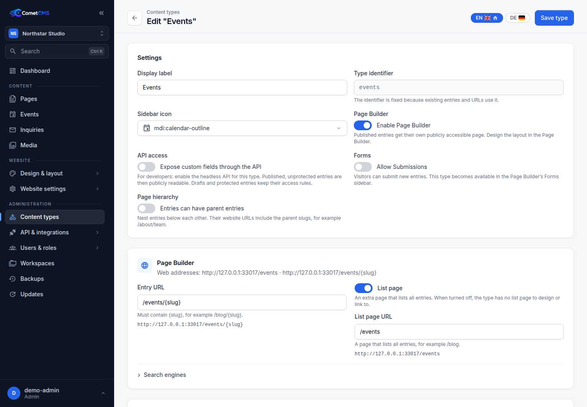

# Content Types

A **content type** defines the structure (schema) for content. Most content types are collections of entries, such as `posts`. A content type can also be marked as a **single page** for one-off content like `start-page`, `contact-page`, or `imprint`.

New content types use the **Page Builder** by default. **Content fields** provide structured values for entries and can be bound to shared layouts, keeping content and design separate.

The headless API is disabled for new types. Enable **Expose content fields through the API** explicitly to make published, unprotected entries publicly readable. Drafts and protected entries keep their access rules. API exposure is independent of website pages. Existing schemas retain their previous API access until reconfigured.



## Creating a content type

1. In the sidebar, under **Administration**, click **Content types**.
2. Click **New content type**.
3. Enter a **type identifier** (e.g. `posts`). The name is used as the collection identifier in the API — use lowercase letters, numbers, and hyphens only.
4. Choose the **Content model**:
   - **Collection** for repeatable content with many entries.
   - **Single page** for one fixed entry.
5. Add content fields (see [Field Types](./field-types)).
6. For forms, enable **Allow Submissions** on a collection and configure the new-entry status, button and messages below.
7. Click **Save**.

Single page content types appear under **Content** in the sidebar and open directly in the editor. Their entry slug is fixed to the content type name, and, when API exposure is enabled, the API read URL is `/api/v1/workspaces/{workspace}/content/start-page`.

## Editing a content type

Open an existing content type to add, reorder, remove fields, or set supported field defaults. Changes to the schema do not affect existing entries — old entries simply won't have the new field value until they are edited and saved.



Field defaults pre-fill new entries in the admin editor and are applied to API-created entries when the field is omitted.

You can change a collection to a single page only when it has at most one active entry. This avoids ambiguity about which existing entry should become the fixed page content.

## Localization

Configure available languages and the default language once in **Website settings → General → Languages** (permission `workspaces.manage`). Every content type and the website use exactly those settings, including languages added later. There are no per-type language overrides or inheritance settings. Previous per-type subsets no longer restrict the available languages. A single-language workspace uses the same model.

Each entry has localized titles, slugs, field values, publication status, and publication dates. IDs, authors, creation dates, and fields marked **Shared across languages** remain shared. Shared values are stored once and edited in the default language.

A missing value inherits the default-language value. An intentional empty value stays empty. An absent or unpublished entry translation stays unavailable publicly, and public fallback never reveals a draft in another language.

Changing workspace languages never copies content or automatically publishes new entry translations. Workspace languages with saved translations cannot be removed until those translations are removed. Unpublish entry translations to hide them publicly without deleting their language or values.

Field labels, help text, and select-option labels also support translations, independently of whether the field's stored values are shared. Option keys and validation rules stay shared.

## Workspace-scoped API access

Content type schemas are workspace-scoped. The same content type name can exist with different field definitions in different workspaces.

For the Public API, use the workspace prefix:

```http
GET /api/v1/workspaces/site-b/content-types
GET /api/v1/workspaces/site-b/content-types/posts
```

Unscoped Public API routes under `/api/v1/...` are rejected with `workspace_required`.

For Admin API requests, the active workspace is selected with the `X-Comet-Workspace` header (or the configured default workspace when the header is omitted):

```http
X-Comet-Workspace: site-b
```

## Deleting a content type

Deleting a content type also removes all entries in that collection. This action is irreversible.

## Content type schema (JSON)

Content types are stored in `cms/storage/workspaces/{workspace}/content-types/{name}.json`. A typical schema looks like:

```json
{
  "name": "posts",
  "label": "Posts",
  "singleton": false,
  "api_enabled": true,
  "fields": {
    "title": { "type": "text", "required": true },
    "slug": { "type": "slug", "required": true, "unique": true },
    "body": {
      "type": "markdown",
      "label": "Body",
      "default": "Start writing..."
    },
    "published": { "type": "boolean", "label": "Published", "default": false },
    "published_at": { "type": "datetime", "label": "Publish date" }
  }
}
```

The schema API returns read-only `locales` and `default_locale` from the workspace. Language settings are not stored in content type schemas or configurable through schema writes. Old language overrides are ignored and removed when the schema is next saved.
