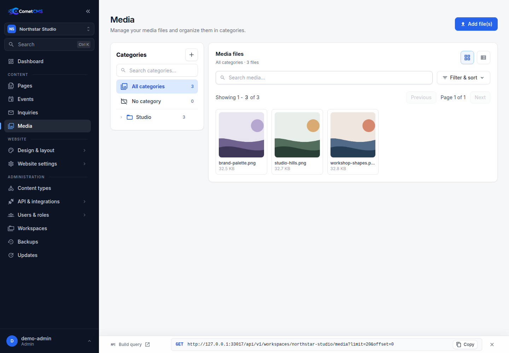

# Media Library

## Uploading files

1. Click **Media** in the sidebar.
2. Click **Add file(s)** and select one or more files.

Supported formats include JPEG, PNG, WebP, GIF, SVG, AVIF, MP4, WebM, QuickTime/MOV, M4V, AVI, MKV, common audio formats, archives, and common document types.

The bundled CMS limit is 1 GiB per file, and the admin upload request has no browser-side timeout. Your PHP and web-server limits still apply. The included Apache/mod_php and PHP-FPM defaults set `upload_max_filesize` to `1G` and `post_max_size` to `1100M`; when using Nginx, a reverse proxy, or a hosting control panel, configure its body-size and request-timeout limits to match. You can lower the CMS limit with `media.max_upload_bytes` in `config/config.php`.



Admin, API, and public form uploads validate detected MIME types against a shared safe extension map. Executable/configuration suffixes and MIME/extension mismatches are rejected. Renaming preserves the original file type; names with additional suffixes such as `file.php.gif` are rejected. Storage must remain inaccessible directly and must never execute scripts; serve files through `/media/{workspace}/{filename}`.

## Organising with categories

Use a file's menu or detail panel to assign it to a category. Categories help you keep large libraries organised. Categories can be nested for finer-grained organisation, for example `Brand / Logos` or `Products / Campaigns`.

## Alt text and title

Open any file to reveal the detail panel. You can set:

- **Alt text** — a short description used by screen readers and as the `alt` attribute in HTML.
- **Title** — an optional tooltip shown when a user hovers over the image.

Both fields are included in the public API response and are saved automatically when you leave the field.

## Visibility

Each file can be set to **Public** (default) or **Private**:

- **Public** — the file is served to everyone and appears in unauthenticated API responses.
- **Private** — the file is hidden from unauthenticated `GET /api/v1/workspaces/{workspace}/media` responses, and fetching the file directly via `GET /media/{workspace}/{filename}` requires a bearer token with `media.read` permission for that file.

Change visibility in the detail panel or use the bulk **Set field → Visibility** action to update multiple files at once.

## Using media in content

Fields of type `media` let you pick a file from the media library directly within the content editor.

## Accessing media files

Uploaded files are served from:

```
/media/{workspace}/{filename}
```

### Image sizes

Every uploaded raster image gets three sizes besides the original:

| Size        | Default | Used for |
| ----------- | ------- | -------- |
| `thumbnail` | 400 px  | The media library, pickers, small images and phones |
| `medium`    | 960 px  | Images in columns and galleries |
| `large`     | 1920 px | Full-width images and the gallery viewer |

Values are the longest side; proportions are kept and images are never enlarged. A size the original does not exceed is served by the original. Change the sizes under **Media → Image sizes** (requires `site.manage`). New sizes are made as images are next requested; **Rebuild all images** makes them all at once.

Request a size by name:

```text
/media/{workspace}/{filename}?size=medium
```

`?variant=thumbnail` still works as an alias for `?size=thumbnail`. Add `format=jpeg` (or another enabled format) to choose the output format.

On the website, images list every size up to `large` in `srcset`, with a `sizes` attribute worked out from the layout: the section's width, the column's span on each device, gallery and card columns, and the image's maximum width. The browser then loads the smallest file that is sharp on the visitor's screen. Originals larger than `large` are never sent to visitors.

Background images load a size per device as well: the smallest one that covers the element on a typical phone, tablet or desktop screen. Tall sections (with a minimum height) keep the large size on phones and tablets, because a covering image is shown larger than the section is wide on portrait screens.

Generated files are stored in the workspace's disposable `media-variants` cache, reused on subsequent requests, and omitted from backups. Deleting or renaming the original also clears them.

Installation-wide defaults for workspaces that have not set their own:

```php
'sizes' => [
    'thumbnail' => 400,
    'medium' => 960,
    'large' => 1920,
],
```

### Width variants

The named sizes are also accepted as widths, for clients that build their own `srcset`:

```text
/media/{workspace}/{filename}?w=960&format=webp
```

Supported output formats depend on the installed GD image encoders and the `media.variants.formats` configuration.

Projects that need exact dimensions can enable `media.variants.allow_custom_sizes`. This accepts any bounded `w`, plus `h` and the `fit` modes `contain` and `cover`:

```text
/media/{workspace}/{filename}?w=800&h=450&fit=cover&format=webp
```

`contain` preserves the entire image within the requested bounds. `cover` performs a centered crop when both dimensions are supplied. Neither mode upscales an image. `max_dimension`, `max_pixels`, and `max_variants_per_image` bound resource and cache usage.

Example configuration:

```php
'variants' => [
    'enabled' => true,
    'allow_custom_sizes' => false,
    'max_dimension' => 4096,
    'max_pixels' => 16000000,
    'max_variants_per_image' => 20,
    'formats' => ['jpeg', 'png', 'webp'],
    'default_format' => 'webp',
    'quality' => 82,
],
```

## Deleting files

Select a file and click **Delete**. This permanently removes the file and its metadata.
