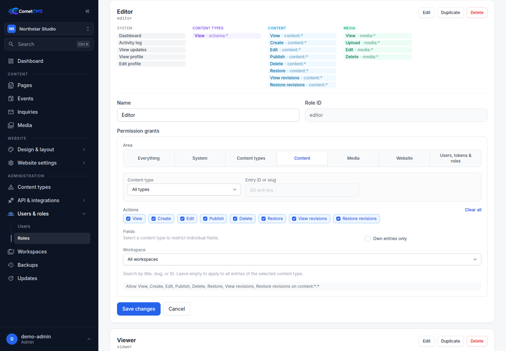

# Managing Users

## User roles

Roles define the permission grants users receive. A user has exactly one role, and changing the role changes the user's effective permissions.

| Built-in role | Default grants                                                                 |
| ------------- | ------------------------------------------------------------------------------ |
| `admin`       | All system, content type, content, media, user, token, role, backup, webhook, and update permissions. |
| `editor`      | Dashboard, activity, updates, profile, schema reads, content, and media writes. |
| `viewer`      | Dashboard, activity, updates, profile, schema reads, content reads, media reads. |

Open the **Roles** tab in **Administration → Users & roles** to create roles or change their grants. The `admin` role cannot be deleted.

## Viewing users

Navigate to **Administration → Users & roles** in the sidebar. Users are grouped by role: Admins → Editors → Viewers.

## Creating a user

1. Click **New user**.
2. Enter a username, password (min 8 characters), and role.
3. Click **Create**.

## Editing a user (admin only)

Admins can click the **Edit** button on any other user's card to update their display name, email, role, or set a new password. You cannot edit your own account from this page — use your [profile page](#your-profile) instead.

## Deleting a user

Click **Delete** on a user's card. This removes the user account only — any content they created (`author_id`) is **not** affected and remains intact.

## Your profile

Click your **name or avatar in the bottom-left corner of the sidebar** and choose **Profile** to open your profile page. From there you can:

- Upload or remove your profile picture.
- Update your display name and email.
- Change your password (current password required).
