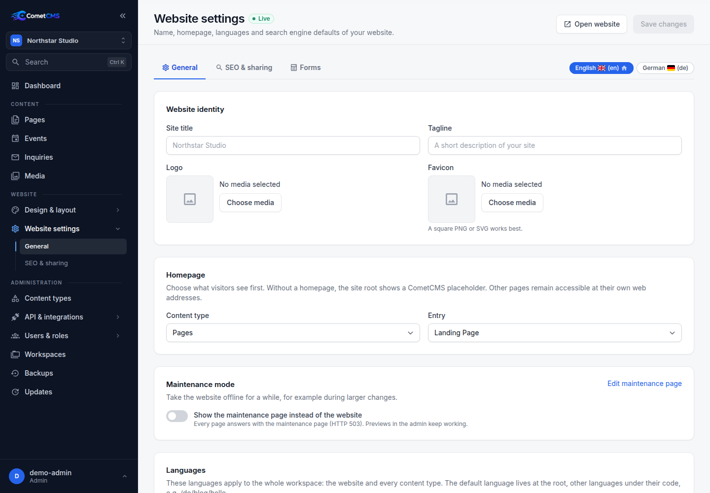
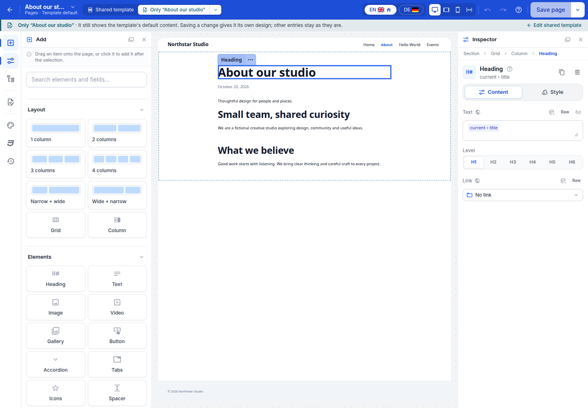
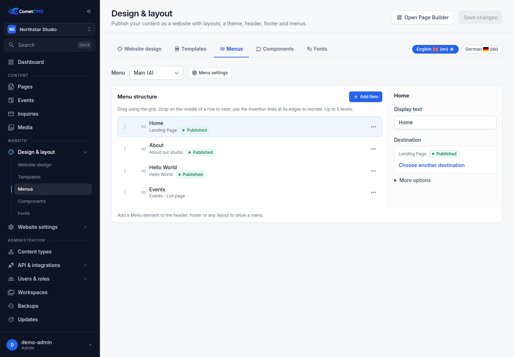

# Website

CometCMS provides a visual Page Builder with shared layouts and structured custom fields. Pages are rendered by PHP on your server, so there is still nothing to install: no Node or build step. Interactive elements, including gallery viewers and internal link modals, use small bundled scripts included only when needed. Developers can also enable the headless API per content type, independently of website pages.

The website is data-driven. You design a **layout per content type** once, and every entry of that type uses it. Editors keep filling in fields; the layout decides how those fields look.

## Putting it online

There is no separate on/off switch. A workspace's website is online while it has something to show: a **homepage**, or at least one content type with the **Page Builder enabled**. With neither, the workspace stays fully headless and the root URL shows a CometCMS placeholder with a quiet space scene.

Expand **Website settings** under **Website** in the admin sidebar (permission `site.manage`) to choose **General** or **SEO & sharing**. General contains the homepage, site title, tagline, logo, favicon, workspace languages and domains. The header shows whether the website is online. SEO & sharing holds the title template, meta description, share image and **Hide from search engines**. **Administration → Workspaces** (permission `workspaces.manage`) creates, renames and archives workspaces. **Website → Design & layout** (shown once a content type has the Page Builder enabled or the website is online) has direct submenu links to the website design, menus, components and fonts. Under **Administration → Content types → edit**, turn on **Enable Page Builder** in the base settings card. Published entries get their own publicly accessible page, with layouts designed in the Page Builder. The **Page Builder** card then appears with URL, search engine and layout settings:

| Setting       | Example         | Description                                                       |
| ------------- | --------------- | ----------------------------------------------------------------- |
| Entry URL     | `/blog/{slug}`  | Where each entry lives. Needs exactly one `{slug}`.               |
| List page     | on / off        | Adds a page listing all entries of a collection, with paging. Off by default. |
| List page URL | `/blog`         | Where the list page lives. Shown while the list page is on.       |

List pages are optional. While a type's list page is off, it does not exist anywhere: its URL is not served, it has no list page layout in the builder or the entry list's template button, and it cannot be chosen as the homepage or as a link destination. Turning it off keeps a customized list layout stored, so turning it back on restores it. Websites created before list pages became optional keep the list pages they had.

`/admin`, `/api`, `/mcp`, `/media`, `/media-thumbs`, `/_site` and `/site-preview` are reserved and cannot be used. **Private** content types are never published, and only `published` (or due `scheduled`) entries are visible — exactly like the public API.

The **Page Builder** column in the content types table shows which types have the Page Builder enabled. Users with `site.manage` can change this setting in the type’s base settings; other users see its status. The Page Builder cannot be enabled for private types. Enabling it for the first content type of a headless workspace puts its website online.

Each content type needs its own entry URL pattern. The website starter serves its **Pages** collection at `/{slug}`, so its entries live at addresses like `/about`.

The homepage can be one entry, a collection's list page (when that list page is on), or **None**. Without a homepage, the site root shows a CometCMS placeholder with a starfield and subtle comet animation. Pages for content types with the Page Builder enabled remain accessible at their own URLs. Set the homepage to **None** and disable the Page Builder for all content types to return to a fully headless setup.

### Maintenance mode

To take an online website down for a while, turn on **Maintenance mode** under **Website settings → General** and save. Every public URL, including robots.txt and the sitemap, then answers with the maintenance page and HTTP 503 with `Retry-After`, which tells search engines that the outage is temporary. Forms and the site search are closed as well. Previews in the admin keep showing the real website. While the mode is on, the header badge reads **Maintenance**.

The maintenance page is a built-in special page, like the 404 page. By default it shows the site logo and name, a short notice and no header or footer. To change it, choose **Edit maintenance page** or open **Maintenance page** in the builder's page switcher. **Reset** restores the default.



## Layouts and the builder

The **Content types** table shows which types have the Page Builder enabled. Open a content type’s **Page Builder** card to configure its URLs and edit its layouts. Every content type has up to two layouts:

- **Entry design** — a single entry.
- **List page** — the page at the list URL, when the type's list page is on.

How entries look inside an entry list is designed in that list itself (see [Entry cards](#entry-cards)).

Layouts are generated from the content type's fields until you change them, so a new type looks reasonable immediately. The top bar marks such a page as **Default layout**; your first saved change creates your own version.



### Finding your way in the builder

- The **left rail** opens the panels: **Add**, **Outline**, **Content** (the preview entry's fields), **Components**, **Design**, **CSS** and **History**. Each panel explains what it does at the top.
- The **canvas** in the middle is the live preview. Click any element to select it; sections, grids, columns and components are outlined in their own colors.
- The **inspector** on the right shows the selected element's settings, a short explanation of the element type, and a path to its parent elements. With nothing selected, it summarizes the page you are editing and suggests next steps.
- The **top bar** shows the preview entry, language, device, undo/redo and whether all changes are saved.
- The arrow beside **Save** opens **Preview**, which shows the last saved version in a new tab even while it is unpublished or the website is off, and **View live page**. Entry layouts preview the chosen entry, list pages their list page, and the header and footer the homepage. Components have no page of their own, so both actions stay disabled there; when an action is unavailable, hovering it says why. **Reset to default** in the same menu shows the generated default of a layout, header or footer. Like any edit it can be undone or cancelled, and it only takes effect when you save; the replaced version stays in **History**.
- Press <kbd>?</kbd> or click the help icon to open the **builder guide** with the basics and all keyboard shortcuts. It opens automatically the first time you use the builder.

If saving fails, the builder keeps a recovery copy in the current browser tab, including pending entry fields and design changes. Reloading the same editor restores that copy. If browser storage is unavailable, a warning asks you to keep the tab open. When the saved layout has changed elsewhere, **Save my layout** lets you explicitly replace it after confirmation; the previous saved version stays in **History**. Clicking Save again alone does not overwrite another edit.

The builder shows a live preview rendered by the same code as the real site. Layouts are built from **sections → rows → columns → elements**. A column can also hold column sets of its own (up to three levels deep), for example a card with an image beside its text. Columns of such a nested set switch between stacked and side by side by the width of the column they sit in, not by the screen width:

| Element      | Shows                                                                         |
| ------------ | ----------------------------------------------------------------------------- |
| Field display | Specialized values such as downloads, repeaters, related cards, badges, or meters. |
| Heading      | Static text, field references, or a mixture of both.                           |
| Text         | Rich text.                                                                    |
| HTML block   | Custom HTML source, including embedded `<style>` blocks.                       |
| Image        | An image from the media library or a bound media field.                        |
| Video        | A media library video, YouTube, Vimeo or an external MP4/WebM/OGV file, with responsive aspect ratio and playback controls. |
| Gallery      | Selected media in a custom order, or media from a bound entry field, in a responsive grid with crop, spacing, and caption controls. |
| Button       | A link to this entry, another entry, a list page, the homepage or any URL.    |
| Accordion    | Repeatable entries with a title, rich text, and an option to start open. Add, duplicate, reorder, or remove entries in the content controls. Enable “Close other entries when opening” to keep one entry open at a time. |
| Icons        | A searchable selection of bundled Material Design icons, with size, color, an accessible label, and an optional link. Works without external icon requests. |
| Entry list   | Entries of any public collection, filtered, sorted and optionally paged.     |
| Menu         | One of the menus from the **Menus** tab.                                      |
| Site title   | Logo, title and tagline from the website settings.                            |
| Languages    | Links to the current page in the other website languages, as codes or names, with a flag beside each, or as flags alone. |
| Spacer, Divider | Space and separators.                                                      |

A column set (row) decides whether its columns sit side by side or underneath each other. Each column decides the same for its own elements under **Arrange elements**: underneath each other (default) or side by side, which wraps onto the next line when there is no room left. Side by side adds **Distribute elements** and **Align elements**, and **Space between elements** becomes the gap between them.

Repeater fields contain an **item template**: the elements inside them are repeated for every row and bind to the repeater's sub-fields.

Elements with a **Link** offer **Open in modal** (the window icon next to the link type) when their destination is **This entry**, **Homepage**, a collection's list page, or another entry. The destination opens inside a modal without its header and footer, keeping its styling, interactive elements and optional section anchor. The modal is as tall as the page's content; longer pages scroll inside it. Close it with a close button, Escape, or a click on the backdrop. **Open in modal** and **Open in a new tab** exclude each other. Inside the modal, other modal links replace the page shown, while all other links open in the whole window; forms stay in the modal after they are sent. Custom web addresses, external URLs, section-only links and dynamic destinations keep their normal behavior. Try modal links on the live website or in the full-page **Preview**.

Choose **Modal** under **Other** in the builder header's page dropdown to design the modal itself. Select the **Modal** panel to set its size, placement (centered, or along an edge of the screen), height, backdrop and whether a backdrop click closes it; its style sets the background, corners, border, shadow and spacing. Inside the panel, add a **Close button**, a **Modal title** (the text of the link that opened the modal), headings, images or rows around **Linked page**, which marks where the opened page appears. The template keeps exactly one Linked page element. Saving applies the design to every modal link in the workspace; **Preview**, undo/redo, **History** and **Reset to default** work here too. The builder and the template's full-page preview show a placeholder in place of the opened page.

To show content that has no page of its own in a modal, such as a sign-up form or terms, create a content type for it with the Page Builder enabled, design its entry layout, and link to its entries with **Open in modal**.

Add a **Gallery** to any column or repeater item template. Choose media manually and drag the selected files to reorder them, or use the content reference picker to bind the gallery to a media field. Set one to six columns, spacing, aspect ratio, image fit and focal point, and optional captions from media titles. Galleries can also be included in reusable components. Existing **Field → Gallery** displays open as Gallery elements with their content reference and styling preserved.

Enable **Masonry layout** to stack images at their natural heights, flowing down each column before the next. The column count and spacing still apply, and captions stay with their images. Crop controls are hidden while masonry is enabled; turning it off restores the saved grid crop settings.

Enable **Open images in a modal** to show the clicked image at full size over a dark backdrop. Close it with the close button, a click on the backdrop, or Escape. **Show previous / next buttons** optionally enables navigation through that gallery, including the arrow keys. Captions follow the gallery's caption setting. The viewer works with grids and masonry; videos, audio, and downloads keep their normal controls. In the builder, select the gallery and click an image again to try the modal. Public pages allow only the exact bundled viewer script through a CSP hash; preview documents still block scripts and the trusted editor controls the viewer.

Drag elements from **Add** onto the preview or into the **Outline**, or click them to insert next to the selection. Select an element to change its content and style in the inspector. Style options come from the theme (sizes, colors, radius, shadows), which keeps every page consistent. Shortcuts: <kbd>Ctrl</kbd>+<kbd>Z</kbd> undo, <kbd>Ctrl</kbd>+<kbd>Shift</kbd>+<kbd>Z</kbd> redo, <kbd>Ctrl</kbd>+<kbd>D</kbd> duplicate, <kbd>Del</kbd> delete, <kbd>Ctrl</kbd>+<kbd>S</kbd> save.

Give elements descriptive names to find your way around larger layouts. In the **Outline**, double-click an element's label or click its pencil button to rename it. Press <kbd>Enter</kbd> or click away to apply, or <kbd>Esc</kbd> to cancel. Clear the name to restore its automatic label. Names are saved with the layout and support undo/redo; they also appear in the inspector and canvas selection without changing the website's content.

If a field is renamed or removed, elements bound to it render nothing and the builder marks them.

### HTML blocks

Add **HTML block** from **Add → Elements** and enter your markup in **HTML source**. The builder preview and published page render the source as entered, including `<style>` blocks, custom attributes, and inline styles. Use unique class names in your CSS to keep it specific to the block; embedded styles follow the normal page-wide CSS rules.

```html
<style>
  .custom-promo { padding: 2rem; background: #f0f4ff; }
  .custom-promo h2 { color: #3344aa; }
</style>
<section class="custom-promo">
  <h2>A custom promotion</h2>
  <p>Markup and styling in one block.</p>
</section>
```

### Videos

Add **Video** from **Add → Elements** and paste a YouTube or Vimeo watch, share or embed URL, or a direct HTTPS MP4/WebM/OGV URL. Alternatively pick a **Library video** from the media library; it takes precedence over the URL and can show a **Poster image** before playback (posters also apply to direct file URLs, not to YouTube or Vimeo). Unlisted Vimeo links retain their privacy hash. Set an accessible **Title**, **Aspect ratio** (including portrait 9:16), **Autoplay**, **Mute audio**, **Loop**, **Show player controls**, **Allow fullscreen** and **Start at (seconds)**. Start time is controlled by the inspector; timestamps in pasted URLs are not imported.

Autoplay also mutes audio to accommodate browser playback policies. Hiding controls does not remove provider branding; some Vimeo options depend on the video owner's plan. For direct files, disabling fullscreen requests that the browser hide its fullscreen button. Provider restrictions, including embedding permissions, still apply.

The editing canvas shows library videos with their player (autoplay is off while editing), and a selectable placeholder for external sources without loading their players; use the full-page **Preview** to test playback. Published pages load YouTube through its privacy-enhanced domain and Vimeo with its do-not-track parameter. Frames are restricted to these providers by the site's Content Security Policy; arbitrary iframe HTML is not accepted.

### Animations

Under **Style → Normal → Animation**, choose an entrance effect and when it plays. **When scrolled into view** plays the entrance once as the element first appears in the viewport, using the theme's speed and stagger delay. **When the page opens** plays on load. Independently, **Style → Hover → Animation** lets you choose a hover effect with its own duration and delay. It starts from the element's current appearance, gently moves, scales, dims or blurs it, and returns when the pointer leaves. Hover colors, borders and shadows fade in over the theme's **Hover transition** time (**Design → Animations**, 0.2 s by default; 0 switches instantly). Reduced-motion preferences disable these effects.

In **Design → Animations**, select **Fast**, **Normal** or **Slow** to edit that duration. Enter an exact time in seconds or use the slider, then replay the entrance cards to see the speed and stagger together. Hover over or focus the sample button to try the separate hover transition.

Scroll inside the preview to test entry animations. Each preview update creates a new page and restores its scroll position, so elements already in view can play immediately. In browsers without [CSS scroll-triggered animations](https://developer.chrome.com/blog/scroll-triggered-animations), entrances progress with scrolling instead; an element already fully in view then looks finished when the effect is enabled. Browsers without view timelines play entrances on page load.

### Shadows

**Shadow** offers the editable sizes **S**, **M** and **L** and the site's **theme shadows** (by default **Block**, **Glow** and **Inset**; see *Design settings → Shadows*). **Text shadow** offers soft sizes, **Block** and **Glow**. Choose a preset, then expand **Customize** to adjust its palette color, horizontal and vertical offset, blur and opacity. Box shadows also have spread and an inset toggle. Editing a value switches to **Custom**, which keeps the settings visible. For block-style depth, use zero blur and an offset with a contrasting color; for a glow, use zero offset and increase blur. Colors follow the site's light and dark palettes; **Black** stays black in both. **None** explicitly removes a shadow, including on a device or state override; **Default** follows the normal or larger-screen value.

### Positioning

Elements and columns offer **Style → Position**. **Free** takes the selection out of the flow and pins it to its section or enclosing positioned column. **Fixed** pins it to the browser window, keeping it visible as the page scrolls. Choose one of nine points under **Pinned to**, then adjust **Move right** and **Move down**, or drag the move grip on the selection in the preview. Hold Shift to move along one axis. Offsets use percentages of the page width on both axes. **Layer** controls overlapping elements.

Position a column to move all its contents together, for example a floating toolbar or sidebar. Its column span controls its width as a fraction of the window for **Fixed**, or of its pin area for **Free**. Resize it with the column width controls or its canvas edge. **In the flow** restores normal grid sizing.

Position, pin, offsets and layer can differ on tablet and mobile. For example, use **Fixed** on desktop and **In the flow** on mobile. **Default** follows the larger screen's setting.

### Tablet and mobile values

Switch the top bar's device to **Tablet** or **Mobile** to change how a page looks on smaller screens. Options with a tablet or phone icon beside their name then change only that device: spacing, colors, link color, alignment, font size, weight and family, text shadow, corners, shadow and maximum width, plus a few layout options (row gap and alignment, column alignment and spacing, section vertical alignment, button size and full width, spacer size). A highlighted icon means the device has its own value; click the reset button beside it to follow the larger screen again. Tablet values also apply to phones unless mobile has its own. On desktop, a small grey icon beside an option shows that it differs on another device. Options without an icon apply to every device.

### Hover and focus

Elements whose look can react to the visitor have **Normal**, **Hover** and **Focus** at the top of the **Style** tab. Hover applies while the pointer is over the element; focus while it, or a link in it, has keyboard focus. These states can change the background, text, link and border colors, box shadow and text shadow; a button can also change its own **Button color**, **Label color** and **Border color**. **Default** keeps the normal value. While a state is selected, the preview shows it on the selected element.

### Conditional elements

Under **Conditional** on the **Style** tab, an element, column, row or section can be shown only for some entries. Each condition picks a field, a comparison (**is**, **is not**, **contains**, **is empty**, **is filled in**) and a value. With two or more conditions, choose whether **all** must match or **any** is enough. Two examples: a second heading that appears only when its field is filled in, or a badge in a list card that appears only when the entry's *Featured* switch is on.

Conditions read the entry being shown. In a list, that is each card's own entry; inside a repeater, it is the row. Fields can follow a relation (for example the author's role). Where there is no entry, such as in the header or on a list page, a field counts as empty. When the conditions don't hold, the element is left out of the page entirely. In the builder it stays visible but greyed out under violet stripes, so you can still select it. The preview checks conditions against the entry chosen in the top bar. Elements without conditions are always shown.

### Button icons

A button can show an icon from the bundled set before or after its label. Choose it under **Icon** in the content inspector, then set **Icon position** and **Icon spacing**. The icon takes the label's size and color. Remove it with the × beside the picker.

### Responsive column order

Select a **row** and enable **Reverse columns on mobile** and/or **Reverse columns on tablet** in the content inspector. Each setting applies independently: mobile is below 768 px, tablet is 768–1023 px, and desktop keeps the original order. All columns are reversed, including rows with more than two columns or columns that wrap onto multiple lines. This changes the visual order; keyboard and screen-reader order still follows the layout tree.

### Backgrounds and gradients

Sections, columns and elements have a **Background image** in the **Background** group of the **Style** tab, next to the background color. The image is layered over the color, which shows through transparent images and while the image loads. Once an image is chosen, the group also offers its size, focal point, repetition (for images that do not cover the area), an overlay that darkens or lightens it, **Background blur (px)** from 0 to 40, and a **Scroll effect**. Like other images, it can be bound to a media field of the entry.

Zero blur keeps the image sharp. The effect applies to a separate image layer, so headings, buttons, menus and overlays stay sharp. The image extends slightly behind the clipped edges to avoid a faded border when blurred.

The **Scroll effect** makes the image react to scrolling. **Fixed** pins the image to the browser window, so the section reveals it like a window while the content scrolls past. **Parallax** moves the image a little slower than the page, giving the section depth. Both work with blur, overlays and rounded corners, and the content itself scrolls normally. Fixed images are sized to the window rather than the section. Parallax uses scroll-driven animations; browsers without them, and visitors who prefer reduced motion, see a still image. Scroll the preview to try either effect.

Choose **Background gradient** in the same group for a two-color **Linear** or **Radial** gradient. Pick its start and end colors from the theme palette (including custom colors); linear gradients also have an angle from 0 to 360 degrees. The colors follow the site's light/dark mode. A gradient takes precedence over a background image; choose **None** to show the saved image again. The background color remains underneath as a fallback. Image blur, sizing and overlays apply to images only.

Headings and Text elements also offer **Text gradient** in the **Text** style group, with the same controls. It colors the text block, including linked and bound text, and works alongside a background color, gradient or image. Code blocks, highlighted text and table headers keep a solid text color for readability on their own backgrounds. **None** restores the regular text color. Browsers without text clipping support keep the regular text color.

Layouts saved before background images became a style keep their section images; they are moved into the section's style the next time the layout is loaded.

### Entry cards

An **Entry list** repeats one card for each entry. For a list look, set **Columns** to 1 and design the card as a row (for example, a title and date without an image); lists saved with the former **List** display open with one column. At first that is the content type's **standard card**, generated from its fields. Choose **Customize card** in the inspector to give the list a card of its own: the first card in the preview becomes editable and every other entry follows it. A card is a column, so it can have a background, border, corners, shadow and padding, and it can hold elements and column sets. Inside a card, **Entry of this card** (`current`) is the entry the card shows, and the **Add** panel offers that content type's fields. **Use standard card** goes back to the standard card.

**Show → Entries of several content types** lists the entries of every type chosen in **Content types** together, newest first (or by another date field). The types need no website pages. Each entry shows its own type's standard card. A customized card works like a search results card (see [Search](#search)): it can show the fields of every listed type, and fields some types lack stay empty. Fixed and visitor filters and the visitor sort options need a single type, so they do not apply in this mode.

To use the same card in several lists, right-click it and choose **Save as component…**, then place that component in another list. Related-entry fields shown as cards use the standard card of the related type. Card layouts from earlier versions keep showing as the standard card of their type.

### Reusable components

A section, column set or column can be saved as a **component**, which reuses it, with everything inside it, on many pages. Right-click it on the preview or in the **Outline**, choose **Save as component…** and give it a name. That spot then shows the component; save the layout to keep it. Open the **Components** panel from the left rail to search all components, drag or click them into the page, edit them, or delete them.

A component is edited in one place. Choose **Edit component** in the inspector or the context menu, or open it from the **Components** tab of the website settings. Saving it updates every page that uses it. A placed component is one unit in the builder: its contents cannot be selected there. A column component placed in a column set keeps its own width. **Detach** replaces a placed component with an ordinary copy that you can change on its own, while the other places keep following the component.

To let each placement change some content, for example a card's title, image and link, edit the component and click the pencil next to an option's name in the **Content** tab. A filled pencil marks the option as **editable per placement**. Select a placed component to see its editable options in the inspector, grouped by element. A value set there applies to that placement only; the arrow beside it goes back to the component's value. Everything else, including the structure and the style, stays the same everywhere. Texts can be translated per placement like any other text. Detaching keeps the placement's own values.

**Copy** and **Paste** in the context menu (or Ctrl+C and Ctrl+V) copy an element with everything inside it. A container such as a section or column takes the copy inside; any other element gets it right after itself. The copy is kept in the browser for the current workspace, so it survives a reload and can be pasted in another tab, in a component, or on another page's layout. **Copy style** and **Paste style** work the same way. Page content copied from another page type gets a page field of its own when pasted.

Components may show fields of the entry a page displays (for example its title or author), and they work with every content type. A field reads the entry that is shown wherever the component is placed: the page's entry, or each card's entry in a list. If that entry has no such field, the field stays empty. Combine this with **Conditional** to hide parts that need it. Any section component can also be any layout's header or footer. In the component's builder, the field picker and the **Fields** list in the Add panel show the fields of all page types. Fields every type has come first, under **All types**, and each type's other fields follow under its name. The preview entry can be any entry of any type, grouped by type in the entry menu, and the type the component was created in comes first. Components can contain other components, but never themselves.

Deleting a component turns all its instances into independent, editable copies, preserving their content, styling and column widths. This applies to layouts, headers, footers and instances inside other components, as well as the open builder draft. Older revisions also restore detached copies. The component and its own version history are permanently removed. Deletion is available in both the builder's **Components** panel and the **Components** tab of the website settings.

### Entry content of single entries

Entries of the same type can look different. Add the **Entry content** element to a type's entry page layout, between sections or inside a column (for example the main column next to a sidebar). Everything around it (header, footer, sidebars, call-to-action sections) stays shared by all entries; the inside belongs to each entry. Sections you place inside the element are the **default content**, which every entry shows until it has a design of its own. If the content type has no page content field yet, placing the element adds one; it appears as the field type `page`.

In the entry editor, **Design in page builder** opens the builder for just that entry. It starts from a copy of the default content and offers everything the builder has: sections, columns, drag and drop, fields of the entry, components and **Detach** for an editable copy. The surrounding layout is shown but cannot be selected. On the **Entry design**, the entry picker in the top bar opens the entry's page content and keeps the entry; unsaved changes are asked about first. The page dropdown switches between the entry design and the **List page**. **Reset to layout default** in the menu beside **Save** shows the default content again as an edit you can undo, and saving removes the entry's own design. The same action in the entry editor applies right away after confirming. Earlier designs stay in **History**.

The page content is one design for all languages. Like layouts, its texts are translated by choosing a language in the builder. Site search and the page's meta description read its texts. Page content is stored in the entry, together with the layout format it was saved in, and is kept as it is if that format changes.

### Tabs

Add **Tabs** from **Add → Elements** to organize content into switchable panels. A new Tabs element starts with two tabs. In the inspector, rename tabs, change their order, add or remove tabs, and choose the **Default tab** shown when the page opens. **Title** provides the tab group's accessible name.

Choose **Edit content** or click a tab heading in the canvas to edit that panel. Each tab holds normal builder elements, including images, buttons, forms, collections and nested column layouts. Use the outline or the inspector's breadcrumb to return to the Tabs element; selecting an element inside a hidden tab reveals it automatically.

Visitors can switch tabs with a mouse or with Left/Right Arrow, Home and End on the tab headings, following the [WAI-ARIA Tabs pattern](https://www.w3.org/WAI/ARIA/apg/patterns/tabs/). Headings scroll horizontally when space is limited. Without JavaScript, all panels remain readable; printed pages include every panel.

### Forms

Forms let visitors send messages, sign-ups or requests. Every submission is saved as a new entry of a content type you choose, so the content type defines what the form asks for. For private inquiries, disable API exposure and the Page Builder on the receiving type.

Set forms up on the **content type edit page** by enabling **Allow Submissions**:

- The current content type receives the submissions and becomes available in the **Form** element's **Content type** selector.
- The form shows **every field of that type** that visitors can fill in, in the type's order, so the form and the entries it creates always match. Labels, help texts, required flags, select options and widths (1/3, 1/2, 2/3) come from the content type's field builder; change them there. Text, textarea, Markdown, number, range, yes/no, select, date, date-time, colour and media fields are shown; relations, repeaters, HTML and JSON fields are left out, and a type where one of those is required cannot be used. Title and slug are filled in automatically.
- **Status of new entries** is *Draft* by default, so submissions wait for review.
- The button label and the messages shown after sending can be changed; empty texts use defaults in the page's language.

Disabling **Allow Submissions** removes the type from the Form element's selector and blocks submissions from existing placements; saved entries and form settings are retained.

Entries are titled with the form's name and the time they arrived. Submissions trigger the usual `content.created` webhook, which can be used to send notifications.

To place a form, click or drag **Form** from **Add → Elements** into the page, then select the **Content type** in the inspector. The form renders that type's fields and saves submissions as entries of the same type. The inspector also lets you hide labels or change the button's style. A text field whose key contains `email`, `phone` or `url` gets the matching input type.

Media fields accept file uploads and respect **Allow multiple** and **Required**. Attachments are stored privately in the receiving workspace’s media library and linked to the new entry; downloading them requires authenticated media access. Visitors cannot attach existing media by posting filenames.

The default limit is **10 MiB per file and 10 MiB total attachments per submission**. Change `site.forms.max_upload_bytes` in `cms/config/config.php` to set both limits in bytes. The effective limit cannot exceed `media.max_upload_bytes`; the form displays it beside each upload input. Allowed file types follow `media.allowed_mime_types`, with executable filename extensions rejected. PHP’s `upload_max_filesize`, `post_max_size`, `max_file_uploads`, and your web server’s request limits also apply; allow room for multipart overhead and text fields in the total request limit. Forms without media retain their 256 KiB request limit (`site.forms.max_body_bytes`); forms with media add the upload budget to that allowance.

Forms without a CAPTCHA work without JavaScript. After sending, the visitor returns to the same page, where the form is replaced by the success message, or shows the error message above it. Spam protection always uses a hidden trap field, and a limit of 5 submissions per visitor and form in 10 minutes (`site.forms.rate_limit_attempts` and `site.forms.rate_limit_window_seconds` in the configuration).

For additional protection, choose **Cloudflare Turnstile**, **Google reCAPTCHA v2**, or **Google reCAPTCHA v3** in the content type’s submission settings. After saving a content type with **Allow Submissions** enabled, **Website → Forms** appears. It lists the content types that accept submissions and provides shared CAPTCHA setup for the current workspace. The content type’s submission settings also link directly to this tab.

In **Website → Forms**, choose **This website** under the provider’s **Use keys from** selector. Enter the site key, secret key, optional allowed hostnames, and the minimum score for v3, then click **Save**. Saved secrets are never returned to the browser; leave the secret field blank to keep a saved key, or enter a replacement. Choose **Server configuration** and save to remove the website’s override and return to the server’s keys. Website keys apply only to the current workspace and take precedence over server configuration. They are stored in `storage/workspaces/<workspace>/form-captcha.json`, outside website exports and backups; configure them again when moving a website to another installation.

Register the website’s domains with the provider. For Google, use **v2 checkbox** keys for `recaptcha` and separate **v3** keys for `recaptcha_v3`. You can also configure server defaults in `cms/config/config.php` under `site.forms.captcha`:

```php
'captcha' => [
    'turnstile' => [
        'site_key' => 'your-public-site-key',
        'secret_key' => 'your-private-secret-key',
        'hostnames' => ['example.com', 'www.example.com'],
    ],
    'recaptcha' => [
        'site_key' => 'your-public-v2-checkbox-site-key',
        'secret_key' => 'your-private-v2-secret-key',
        'hostnames' => ['example.com', 'www.example.com'],
    ],
    'recaptcha_v3' => [
        'site_key' => 'your-public-v3-site-key',
        'secret_key' => 'your-private-v3-secret-key',
        'hostnames' => ['example.com', 'www.example.com'],
        'min_score' => 0.5,
    ],
    'workspaces' => [],
],
```

The shipped configuration also reads `COMET_TURNSTILE_SITE_KEY`, `COMET_TURNSTILE_SECRET_KEY`, `COMET_RECAPTCHA_SITE_KEY`, `COMET_RECAPTCHA_SECRET_KEY`, `COMET_RECAPTCHA_V3_SITE_KEY` and `COMET_RECAPTCHA_V3_SECRET_KEY` from the environment. `hostnames` optionally restricts successful responses to exact hostnames (no scheme, port or wildcard); an empty list relies on the provider’s domain restrictions. For separate keys per workspace, set `site.forms.captcha.workspaces.<workspace-slug>.<provider>` to the complete provider configuration above. A workspace override replaces that provider’s shared configuration, including its hostname list and v3 score threshold.

v3 checks visitors automatically when they submit, with a visible reCAPTCHA badge inside the form. Each attempt requests a fresh token before continuing the normal form submission, including validation and attachments. Tokens must match the form’s action and meet the configured `min_score` (a number from 0 to 1, default `0.5`). Responses below the threshold are rejected; they do not create entries or switch to a checkbox. Adjust the threshold using your site’s score distribution in Google’s console. A page can contain both v2 and v3 forms; they share one Google API script and retain separate keys.

Keys are stored separately from content types and submission settings. Only the public site key is rendered into the page. CAPTCHA forms require JavaScript and outbound HTTPS from PHP to the provider. Missing configuration, rejected or expired tokens, provider error responses and verification outages block submissions before attachments or entries are saved. Turnstile and v3 responses are also checked against the form’s action. Custom clients must send `cf-turnstile-response` or `g-recaptcha-response` as a form field alongside `fields[...]`; for v3, execute the action from the form’s `data-action` attribute immediately before posting. With `Accept: application/json`, failures return HTTP 422 with `error.fields.captcha`.

Each page loads only the CAPTCHA providers it uses, once per provider even when it contains multiple forms, with the required Content Security Policy permissions. Builder and full-page previews show a placeholder instead of contacting CAPTCHA services. Cached pages refresh when public keys or configuration readiness change.

Provider integration references: [Turnstile verification](https://developers.cloudflare.com/turnstile/get-started/server-side-validation/), [reCAPTCHA v2 widgets](https://developers.google.com/recaptcha/docs/display), [reCAPTCHA v3 scores and actions](https://developers.google.com/recaptcha/docs/v3), [explicit v3 rendering](https://developers.google.com/recaptcha/docs/faq), [reCAPTCHA verification](https://developers.google.com/recaptcha/docs/verify).

### Search

Add **Search** from **Add → Elements** to give visitors a search field, e.g. in the header. As they type, up to seven matching pages drop down below the field; arrow keys move through them, Enter opens the highlighted (or best) hit and Escape closes the list.

In the inspector:

- **Search in** picks the content types to search. Only types with website pages are offered, because every hit links to a page. With none checked, every type with pages is searched, including types added later.
- **Search fields** picks what is compared: the title and the text, textarea, Markdown, HTML and select fields of the chosen types (select fields match both their option keys and labels). With none checked, the title and all of these fields are searched.
- **Maximum results** (1–7) and **Search from characters** (1–5) control how many hits show and when searching starts.
- **Placeholder**, **Icon** (left, right or none, and which icon), **Style** (outline, filled or a single line), **Size**, **Show content type of results** and **Text without results** change how it looks. Empty texts use defaults in the page's language. **Corners** under *Style → Shape* round the field too; *Full* turns it into a pill.

Hits are ranked by where the text matches: titles that start with it first, then titles with a word that starts with it, then other title and field matches, newest first within each group. Only published entries of public content types are found, in the page's language, and a hit carries nothing but its title, URL and content type, so search reveals nothing the website itself does not show.

The dropdown needs JavaScript; without it, the field is shown but does nothing. Requests go to `/_site/search/{workspace}`, are cached by browsers for a minute, and are limited to 120 per visitor and minute (`site.search.rate_limit_per_minute` in the configuration).

#### Search results page

Turn on **Open the search results page on Enter** on a search element to send searches to a page of their own instead of only showing the dropdown. Enter then opens the results page unless a hit is highlighted with the arrow keys. The dropdown still shows hits while typing. The field is a normal form, so it also works without JavaScript.

The results page is a built-in special page, like the 404 and maintenance pages. Open **Search results page** in the builder's page switcher to design it. By default it has a heading, a search field and an **Entry list** set to **Show → Current search results**. This mode is offered only on the search results page; an entry list elsewhere that is still set to it shows a warning in the builder and nothing on the site. It lists the hits ranked as described above, from all content types with website pages or the ones chosen in **Search in** / **Search fields**. Without a card of its own, each hit shows its type's standard card. **Customize card** gives the list its own card, starting with title and date. It can show the fields of every searched type: with one type in **Search in**, all of that type's fields; with several or none, the fields of all of them. Fields every searched type has are marked **All types** and listed first. Other fields show which types have them and stay empty on hits of other types. In the builder there is no query, so the newest entries stand in for hits while you design the card. **Number of entries**, **Columns** and **Show page numbers** work as for other lists; the content type, sorting and visitor filters do not apply in this mode.

How the query travels:

- The page answers at `/search` below the language prefix, e.g. `/search?q=garden` or `/de/search?q=garten&page=2`. The path is fixed and not translated. It takes precedence over an entry whose URL would also be `/search`.
- `q` is the search text, trimmed and limited to 100 characters. `page` is the page number of lists with page numbers; their page links keep `q`.
- The search runs in the page's language, so `/de/search` finds the German texts. The language switcher keeps the query.
- Without a query (or with one shorter than two characters) the list shows nothing. A query without hits shows the list's **Text when empty**, or "No results found".
- Each query and page is cached as its own page. Results pages are marked `noindex` and have no canonical URL.

In the builder, **Preview** opens the results page with unsaved changes and an example query: a word from the newest titles that finds the most hits. Searching there stays in the preview. **View live** opens `/search`, which shows no hits until you search.

Searching again on the results page only loads the same page with the new query. Nothing redirects on the server, so a search field on the results page cannot cause a redirect loop.

### Light/dark toggle

Add **Light/dark toggle** from **Add → Elements**, e.g. to the header, to let visitors switch between light and dark mode. It shows the icon of the mode that is on (**Light mode icon** and **Dark mode icon**); **Size**, **Style** (plain, outline or filled) and **Show text** change how it looks. The **Text** is shown next to the icons or, when hidden, read out by screen readers; empty, it is “Dark mode” in the page's language.

The choice is remembered in the visitor's browser and applies on every page that has a toggle, before the page is drawn. Until a visitor chooses, the theme's mode applies (with **Auto**, the system setting). The dark colors come from **Design**, so set them even for a light-only theme. The toggle needs JavaScript; without it, the button does nothing.

### AI and MCP access

The builder stores layouts as structured JSON and shares its schema with the server renderer. This is a suitable foundation for AI design tools. The current MCP endpoint exposes content, schemas and media; website design tools have not been added yet. See the [MCP website design assessment](../api/mcp#website-design-readiness) for the current capabilities and remaining integration work.

## Header, footer and menus

The header and footer are shown on every page and are edited directly in the page builder: select the header or footer to edit its shared layout. Menus are managed in the **Menus** tab and can link to the homepage, list pages, entries or any URL, with up to five levels of nested items and per-language labels. Select an item in the menu tree to edit it. Drag items before, after or inside another item, or use the move and indent/outdent buttons. Group headings can contain children without linking anywhere. Deleting a parent asks you to confirm removal of the entire branch.

Menu elements show a navigation list on desktop and collapse into a menu button on mobile by default. Enable **Always show menu button** in the element's content options to use the button at every screen size, including desktop. **Menu button opens** chooses what the button shows: a dropdown under the button, a full-screen menu with large centered links, or a side panel over a dimmed page. **Side panel position** chooses whether the panel slides in from the left or right (the default). For full-screen menus and side panels, **Menu panel background** and **Menu panel text color** select colors from the theme palette, including custom colors; **Default** keeps the theme's background and text colors. These colors apply to the open panel's content and close button. Full-screen menus and side panels have their own close button (clicking the dimmed page also closes a side panel), and the page behind them does not scroll while they are open.

**Hover effect** sets how a hovered link stands out: a highlighted row (the default), a color change only, an underline, an overline, or an underline that grows from the middle. Lines use the theme's link thickness and distance. **Hover color** picks the color hovered links and the current page take; **Default** uses the element's text color or the section's highlight color. Dropdowns and panels keep their own colors. **Current page** marks the link of the open page in bold (the default), with the same effect as a hovered link, or with its color only.



### Templates

A **template** puts a page together from three parts: a **header**, a **content area** and a **footer**. It holds no design of its own, so the same header, content area or footer can appear in several templates. Each content type has templates for its entry pages and, when turned on, for its list page.

- **Header** and **footer**: the site header or footer, **none** (for landing pages and similar), or any section component that is shared or belongs to that content type, for example a blog header that shows the post's category.
- **Content area**: the main part of the page, designed in the page builder. Every page kind starts with its **Default content**; add more, such as "Long read" or "Compact", to give entries of the same type different layouts. A new content area starts empty; **Reset to default** in the builder empties it again.

Templates are tried **in order**: an entry page uses the first template whose **conditions** all match the entry, for example *Category is Tips* or *Featured is yes*. The **Default** template is always last, has no conditions and applies to everything else. List pages have no entry to compare, so their templates have no conditions. An editor can also choose a template for a single entry under **Template** in the entry's settings; that choice comes before any conditions, and **Automatic** goes back to them. The hint below the field says which template applies and why.

Manage templates under **Design & layout → Templates**: choose a content type and page kind, add, duplicate, rename or delete templates, drag them into order, and set their conditions. The page outline on the right shows the selected template; click its header, content or footer to choose another part, create a content area, or open the part in the builder. Changes are saved with **Save**.

As long as a page kind has only its Default template and Default content, the page builder and the preview look as they always did; the template controls below appear once it has a second template or content area. In the page builder, the top bar then shows the template the canvas shows around the content area (**Template: …**) and why. Its menu previews the content area with another template (the one the page uses on the website is tagged **Using**), switches to another content area of the page kind, or starts a new one. Picking another entry to preview moves the canvas to the template and content area that entry uses on the website. Select the header or footer in the canvas to choose under **Shown on these pages** what that template shows there; **Edit** opens the header, footer or component itself. The page dropdown lists, for each content type, its templates and their three parts, each of which opens in the builder.

In the full-page preview, the admin bar's **Template** menu names the template the page uses, why, and links to its header, content area and footer. Deleting a component that a template shows brings back the site header or footer there; a content area cannot be deleted while a template shows it.

### Sticky and floating headers

Each section has a **Scrolling** group in its content settings, usually used for the section in the header that holds the logo and menu:

| Option                           | Effect                                                                                                                                                                                                                                               |
| -------------------------------- | ---------------------------------------------------------------------------------------------------------------------------------------------------------------------------------------------------------------------------------------------------- |
| **Stick to the top**             | **Always** keeps the section at the top of the window down the whole page. **When scrolling up** hides it while the visitor scrolls down and brings it back as soon as they scroll up. Other header sections, such as a top bar above, scroll away normally. |
| **Float over the content below** | The section takes no room, so the page's first section (a hero image, for example) starts underneath it.                                                                                                                                            |
| **At the top of the page**       | For floating sections: **Transparent** lets the content below show through until the visitor scrolls, then shows the section's background. **Background** keeps the background the whole time, for a header that simply stays in place over the page. |
| **When scrolled**                | For sticky and floating sections: add a **Shadow**, make the background **Frosted** (translucent and blurred), or make the section **Compact** by reducing its vertical padding.                                                                      |

A floating sticky section is pinned to the very top of the window, so use it as the header's first section. When editing the header, the preview gets extra room so you can scroll it and try these options. These effects use CSS scroll states and require no JavaScript. Browsers without them, such as Firefox, keep **When scrolling up** sections always visible, show floating sections with their background, and skip the scroll effects.

The destination picker separates pages, content entries, listing pages, custom links and sections. Content search is paginated and shows publication status; drafts and scheduled entries can be selected while preparing navigation, but linking them does not make them public. Only public content types with website routes (or homepage destinations) are offered.

Element **Link** controls use the same destination picker, including Field and Gallery elements. Choose a page, entry, listing, custom URL, section, the current entry, or no link. The database icon binds the destination to a URL field or another compatible content reference, resolved for each entry or repeater item. Links can open in a new tab. Existing **Link to the entry** switches are preserved as **This entry** or **None** destinations. Gallery modal viewers take precedence over image links while enabled.

For a section link, enter an anchor ID assigned in the page builder, such as `contact` or `#contact`. Choose **Section** to jump within the current page, or add an optional section to a page, entry or listing destination. Custom links also accept website paths, external URLs, `mailto:` and `tel:` links. Parent links and submenu disclosure buttons work independently on the published website.

## Theme

Open **Website → Design & layout → Website design** (or **Design** in the builder rail) to set colors for light and dark mode, choose whether to follow the visitor's system preference, and adjust fonts and sizes, with a live preview. Choose system font stacks or install the families you need. The website starter downloads Inter and Lora as normal installed fonts; you can replace or remove them once they are no longer used. Empty workspaces start without installed fonts. **Manage fonts** opens the installed library, the online catalogue and custom uploads; the same library is also available as the **Fonts** tab on the Page Builder settings page. Every family is shown as a live specimen, and you can type your own preview text and change its size. Website and editor font files are always served from your CometCMS installation.

The **Catalogue** lets website managers search and filter Fontsource families by category, see each family's preview as it scrolls into view, and install selected character sets. Latin and extended Latin are selected by default where available. Installations show progress and can be cancelled or resumed after an interruption. Catalogue access requires outbound HTTPS from the PHP host; installed fonts continue working offline. Updates happen only when you choose **Update font**.

**Upload** accepts custom WOFF2 files, with a family name, fallback category, style and weight for each file. Drop files onto the upload area; style and weight are suggested from the file names and each file shows a local preview before upload. Enter identical start and end weights for a static face, or the supported range for a variable face. Upload italic files separately and confirm permission to use the fonts. You can add more files to an existing custom family. Files are limited to 10 MiB each and 100 MiB per family, subject to your host's upload limits.

Installed fonts are available for body text, headings, H1–H6 overrides and individual builder elements. System stacks and the Body/Heading element options remain available. Only faces used by the page are downloaded by the browser. Missing files use fallback fonts and are marked in the editor.

Site backups include installed fonts and their metadata. Fonts referenced by saved designs or the current draft cannot be removed; the library shows their usages. System font stacks remain available with every installation.

**Heading levels** fine-tune H1 to H6 one by one: font, size, weight, line height, letter spacing and capitalization. Empty values follow the general typography settings, so a level only needs the values that should differ. Custom sizes from 32 px shrink by 20 % on phones. Font, size and weight chosen for a single element in the builder still take precedence.

**Links** sets how text links look across the site: their color and hover color from the theme palette (including custom colors, so dark mode follows along), whether they are underlined always, only on hover, or never, and the underline's thickness and distance from the text. Heading links and **Link** style buttons use the same hover color and underline. Links in colored sections, and elements with their own **Link color**, keep theirs. Themes saved with the earlier **Underline links** switch keep their look.

The theme also defines the **tokens** the builder offers, so one change reshapes the whole site:

- **Spacing scale** — the pixel values behind XS to 2XL for padding, space below and spacers (Compact / Normal / Relaxed fill them in).
- **Corners** — the S, M and L radii, and the default corner used by buttons, images, cards and “Theme default”. “Round” turns buttons into pills while images and cards use L.
- **Shadows** — select S, M or L to customize its shadow, preview it and reset it individually, just like corners. Additional theme shadows are offered by every element's **Shadow** setting. Add, rename, adjust or remove theme shadows here; a change updates every element that uses it. A removed shadow is no longer shown, and the element's setting reports it as missing.
- **Widths** — the maximum content width of “Contained” and “Narrow” sections.

Administrators can add **custom CSS**. Every class the website uses starts with `c-`, e.g. `.c-site-name` or `.c-button-primary`. Elements also accept extra CSS classes in the builder.

### Theme folder

Each workspace keeps the whole design of its website in one folder, `storage/workspaces/{workspace}/site/theme/`, so it can be versioned with git or copied on its own:

```
theme/
  theme.json                    design settings
  style.css                     custom CSS
  regions/header.json           header and footer
  regions/footer.json
  content/{type}/detail/{area}.json   content areas of a content type's entry pages
  content/{type}/index/{area}.json    and of its list page
  templates/{type}/{variant}.json     its templates, where they differ from the default
  components/{name}.json        reusable components
```

Public pages load `style.css` after the generated theme styles. The builder previews unsaved CSS immediately, and theme revisions include both settings and CSS. You can also edit `style.css` directly; stylesheet versions and page caches account for its contents.

Components are stored under their name, e.g. `components/hero-banner.json`, and layouts refer to them by that name. Renaming a component in the builder keeps its file name, so placements stay intact. The files contain no save times: saving without changes leaves them untouched, and the time shown as "last changed" is the file's modification time. Revisions are kept outside the folder, in `storage/workspaces/{workspace}/revisions/site/`. Settings, menus and forms belong to the site rather than its design and stay in `site/`. Website backups include all of it.

Workspaces from earlier versions move their headers, footers, layouts and components into the theme folder on the first request after updating. Layouts from before templates (`layouts/{type}/{variant}.json`) become each page kind's default content area, with their history, and their header and footer choices become the default template. Components with generated names such as `ce1f4a17586` get readable names, and every placement, also in revisions, is updated. Backups made before this change can still be restored. Existing `site/theme.json` files remain readable and move into the folder the next time the theme is saved.

## Languages

Configure languages once in **Website settings → General → Languages** (permission `workspaces.manage`; others see the current choice). They belong to the active workspace: the website and every content type always use those languages and their default directly. The default language lives at the root; other languages use their code as a prefix. Slugs and route paths can be translated, for example `/articles/about` and `/de/artikel/ueber-uns`. Internal links use stable entry IDs, so changing a slug does not break them.

Removing a language deactivates it. Its website content is hidden and it disappears from language switchers, while saved translations and publication states remain intact. Add the language again to restore them. Changing the default language does not translate or move existing content. Entry URLs without a published version in the new default language return 404; an unavailable default-language homepage shows the generated homepage instead.

The builder keeps one shared structure and design. Choose a language to edit its headings, rich text, button labels, images, links, tabs, and other visitor-facing values. **Translate content** prevents structural edits; **Shared design** enables shared layout changes. Source text, inheritance, reset actions, and review indicators appear in the inspector. Component translations apply wherever the component is used; header and footer translations work the same way. A literal in a collection layout applies to every entry using it; bind a custom field when the value should differ per entry.

Site identity, metadata, error pages, navigation, form text, field presentation labels, and media alternative text and captions use the same localized-value model. Language selectors in these editors share the active language. Built-in visitor messages use a separate language dictionary.

Publish entry translations independently. Missing values within a published translation inherit public default-language content; an empty override stays empty. Missing or unpublished page variants return 404. Sitemaps, canonical URLs, `hreflang`, and the language switcher use available published variants. Shared design, components, and settings keep their existing save lifecycle.

The **Languages** element links each page to its published translations and omits unavailable languages. **Flags** shows the text only, a flag beside the text, or the flag alone; a flag on its own is named for screen readers and shows the language name on hover. Flags stand for languages, so they follow a convention: English shows the British flag and regional codes use their region (`de-at` shows Austria's flag, `pt-br` Brazil's). A language without a flag keeps its text.

## Search engines

Pages get a title (template in **Website settings → SEO & sharing**, e.g. `{title} · {site}`), a description and a share image taken from the entry (or chosen per content type), a canonical URL, `/sitemap.xml` and `/robots.txt`. **Hide from search engines** adds `noindex` while a site is being built.

## Previewing drafts

For entries with a Page content field, **Design in page builder** opens that entry's own content; the surrounding layout stays shared. **Edit shared template** opens the content type's shared design, and changes there apply to every entry using it. Entries without a Page content field offer the shared design action directly. In the builder, the save button's menu offers **Preview**, which opens the last saved layout with the sample entry, drafts included, for signed-in users only and marked with a preview banner. Save first to include unsaved layout changes. The same menu has **View live page** for the published page, and the top bar links back to the entry's content. Published entries also offer **View on website** in the editor header.

## Domains and workspaces

The default workspace's website answers on the server's own address. To serve another workspace's website, add its domains in **Website settings → General → Domains** and point those domains at the same installation.

## Performance and security

- Pages, 404 responses, the sitemap and robots.txt use the workspace's public API cache (`cache.enabled` and `cache.ttl`, 300 seconds by default). Content, schema, media and website configuration changes clear that workspace's cache. A scheduled publication shortens the cache lifetime so it becomes visible as soon as it is due.
- Cache entries are separate for each workspace, origin, installation prefix, path and page number. Unrelated query parameters do not create extra entries. Draft and builder previews bypass the public cache.
- Public pages set no cookies and support `ETag` revalidation; the stylesheet is versioned and cached for a year.
- Pages are sent with a `Content-Security-Policy` that blocks scripts except for the exact bundled gallery, link modal, Tabs, Search and theme toggle scripts when needed, allowed by their content hashes. Content is escaped, and rich text and Markdown pass the same HTML allow-list as HTML fields. HTML blocks preserve builder-authored source, including embedded CSS; the page's script policy still applies.
- Layouts are data: every value is checked against a fixed vocabulary before it reaches the page.

Website settings are included in backups as the **Website** part.

## Dynamic content and smart tags

<div v-pre>

Ordinary elements can use manually written content, a field value, or text containing several field values. Click the database icon beside a supported property to choose its content source. Clicking an inserted chip edits its reference, formatting, and empty-value fallback. **Raw** switches to the source view, where you can edit content and smart tags directly; **Visual** switches back to the visual editor. Invalid tags must be corrected before saving. **Use static content** removes the binding.

Supported properties are heading text, Text content, image and gallery sources, button label, background images, and element link destinations. Image alt text and captions come from the selected media item's alt text and title. Other layout and style controls stay static. The **Custom Fields** sidebar contains shortcuts: Title inserts a bound Heading, scalar content inserts Text, single-image media inserts an Image, and multiple-media fields insert a Gallery. Files, relation lists/cards, repeaters, badges, meters, swatches, and JSON retain specialized displays using the same reference system.

The picker offers these sources:

| Source | Smart tag example |
| --- | --- |
| Current entry | `{{ current.intro_text }}` |
| Current repeater item | `{{ item.heading }}` |
| Specific entry | `{{ entry.services["stable_uid"].description }}` |
| Site information | `{{ site.title }}`, `{{ site.tagline }}`, `{{ site.year }}` |

A single-entry relation can be followed, such as `{{ current.author.bio }}`. Entry sources expose `url`, including `{{ current.author.url }}`. Specific entries use stable UIDs so slug changes do not break references. Inside a repeater, Current item means its row and Current entry means the containing entry. Inside an entry list's card, Current entry is that card's entry. Current entry is unavailable in shared header/footer and list-page editors; use a specific entry there.

Text can combine references with manual content, such as `Meet {{ current.author.title }}.` Images and link destinations require a complete reference of a compatible type. Multiple values need a specialized list/gallery/repeater display; a scalar element never silently selects the first value. Rich text and Markdown render their formatting when bound as the entire Text content. References embedded within other text become escaped plain text. Tags cannot be inserted into HTML attributes; use the dedicated image and link properties.

Formatting operations follow a pipe:

```text
{{ current.author.title | fallback:"Our team" }}
{{ current.published_at | date:"long" }}
{{ current.body | truncate:30 }}
```

`date` accepts `date`, `long`, `datetime`, or `time`. `truncate` limits words from 1 to 500. Fallbacks apply to missing or empty content; zero and false remain real values. Write `\{{` for literal opening braces and `\\` for a literal backslash in the syntax editor. Arithmetic, conditions, arbitrary functions, and recursive interpretation of field content are not supported.

References stay within the current workspace and use the active website language. Referenced content must be published and belong to a public content type, even when previewing a draft root entry. Private or missing media is not exposed. Relation paths follow at most five links. The builder marks unresolved references; published pages use the fallback or empty output.

The smart-reference layout format replaces the development format. Older saved layouts and header/footer designs show generated defaults with a notice until saved in the new format. Older layout revisions cannot be restored. Posts, schemas, media, website settings, menus, and theme are preserved.

</div>
