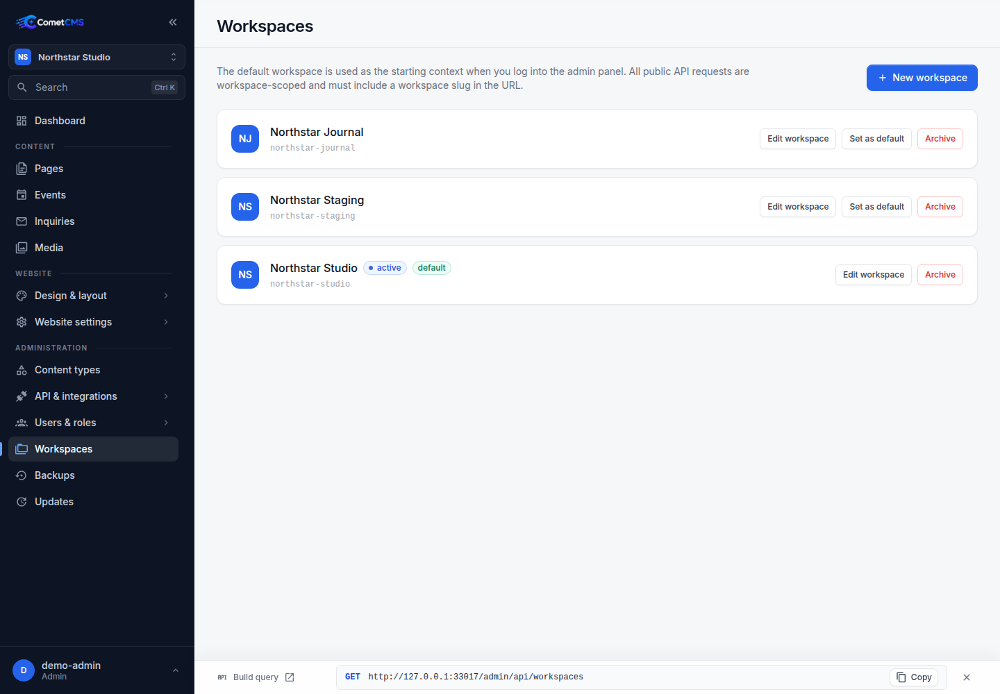

# Workspaces

Workspaces let you partition content, media, and content types within a single CometCMS installation. Each workspace is completely isolated — its entries, schemas, and uploaded files are stored separately.

Common use cases:

- Manage multiple websites or apps from one admin panel.
- Separate staging and production content without running two CMS instances.
- Give different teams their own isolated content area with scoped permission grants.

## What workspaces isolate vs share

Workspace-scoped data:

- Content entries
- Content type schemas
- Media files and media metadata
- Revisions
- Trash
- Public API cache
- Workspace languages
- Website settings, menus, theme, templates, components and fonts
- Form CAPTCHA overrides

Shared installation-wide data:

- Users
- Roles
- Access tokens
- Webhook settings
- Backup files
- Update settings and runtime app settings

This means you can keep one team directory and auth model while still separating website data by workspace.

## How workspaces map to API routes

Every workspace has a **slug** (a short URL-safe identifier). The slug determines which API path prefix is used to access that workspace's content.

### Public API routes

Public API routes are always workspace-scoped through the URL prefix:

```http
GET /api/v1/workspaces/site-a/content/posts
GET /api/v1/workspaces/site-a/content-types/posts
GET /api/v1/workspaces/site-a/media
```

Unscoped routes under `/api/v1/...` return `workspace_required`.

### Admin API workspace selection

Admin API routes select a workspace through the `X-Comet-Workspace` header. If omitted, CometCMS uses the configured default workspace.

```http
X-Comet-Workspace: site-b
```

| Route pattern                                        | Description                                     |
| ---------------------------------------------------- | ----------------------------------------------- |
| `GET /api/v1/workspaces/{slug}/content/{type}`       | List entries from a specific workspace          |
| `GET /api/v1/workspaces/{slug}/content-types/{type}` | Content type schema for a specific workspace    |
| `GET /api/v1/workspaces/{slug}/media`                | Media list for a specific workspace             |
| `GET /media/{slug}/{filename}`                       | Serve media file from a specific workspace      |
| `GET /media/{slug}/{filename}?variant=thumbnail`     | Serve the thumbnail variant from that workspace |

### Workspace header

For admin endpoints (`/admin/api/...`), clients can select a workspace per request with `X-Comet-Workspace`:

```http
X-Comet-Workspace: site-b
```

For public endpoints, use `/api/v1/workspaces/{slug}/...`.

## Default workspace

The workspace chosen during setup becomes the configured default. Its slug comes from the name you entered; an installation does not require a workspace named `default`.

To change the default:

1. Open **Administration → Workspaces**.
2. Click **Set as default** next to an active workspace.

The default selects the workspace for admin requests without `X-Comet-Workspace` and the website served on the installation's own address. Public API requests always need `/api/v1/workspaces/{slug}/...`, including for the default workspace.



## Creating a workspace

1. Go to **Administration → Workspaces**.
2. Click **New workspace**.
3. Enter a label and (optionally) a custom slug. The slug is derived from the label automatically.
4. Select the workspace languages and default language. Sample content is assigned to the default language, and additional languages are available for translations.
5. Choose a starting point. **Start with a website** is selected by default and creates a Pages collection with sample content, a Landing Page entry as the homepage, navigation, and a configured homepage. The Page Builder is enabled. **Start empty** creates no content types or entries.
6. Click **Create**.

New-workspace website starters omit Events; the first-install website starter still includes them.

Slugs are immutable after creation. Choose them carefully.

## Archiving a workspace

Archived workspaces are hidden from the workspace switcher and from the API. Their data is preserved on disk.

The last active workspace cannot be archived. Archiving the configured default automatically selects another active workspace as the default. Archived data stays on disk, and its slug remains reserved.

To archive, click **Archive** next to the workspace and confirm. The admin UI provides archival rather than permanent workspace deletion; the Admin API's `DELETE /admin/api/workspaces/{slug}` also archives without removing files.

## Workspace icons

Upload an icon (JPEG, PNG, WebP, or GIF — max 10 MB) to help visually distinguish workspaces in the switcher and admin list.

Click the workspace avatar to upload a new icon. To remove an existing icon, click **Remove icon** in the action row.

## Permissions and workspace scoping

Permission grants can be scoped to a specific workspace. For example:

| Action | Resource | Effect |
| --- | --- | --- |
| `content.read` | `workspace:*:content:*` | Read content in all workspaces |
| `content.update` | `workspace:site-b:content:*` | Update content only in `site-b` |
| `content.read` | `workspace:site-b:content:posts:*` | Read only the `posts` collection in `site-b` |

Actions and resources are separate grant properties. Publication also requires `content.publish`; update access alone does not grant it.

When creating or editing an access token or user role, choose a workspace from the **Scope** dropdown in the permission grants editor to restrict a grant to a single workspace.

## Storage layout

Each workspace stores its data in workspace-scoped sub-directories:

```
cms/storage/
  workspaces/{workspace}/
    icon.png                     # Workspace icon
    content/                     # Content entries
    content-types/               # Content type schemas
    media/                       # Uploaded media files
    media-meta/                  # Media metadata
    media-variants/              # Generated variants, including thumbnails
    revisions/                   # Revision history
    trash/                       # Soft-deleted entries
```

Every workspace directory uses its own slug, including whichever workspace is configured as the default.
